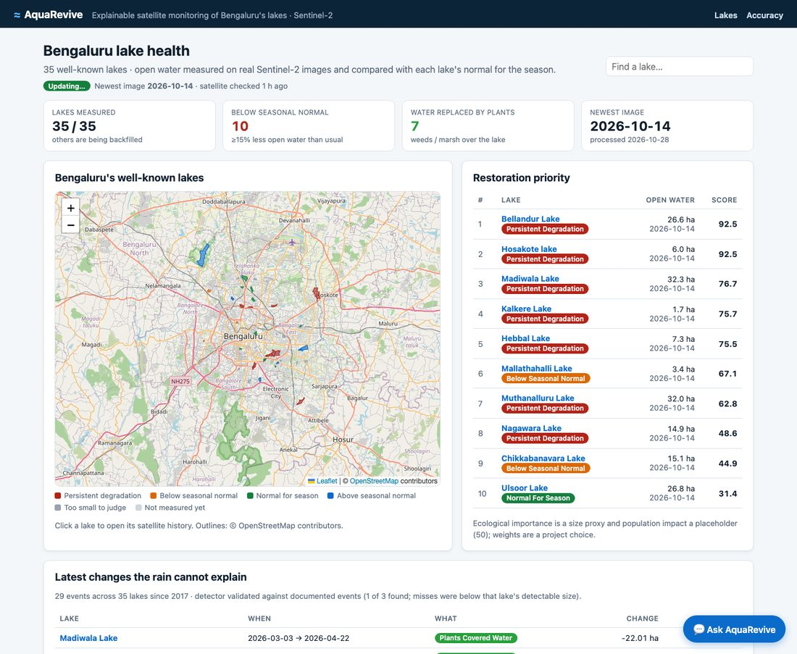
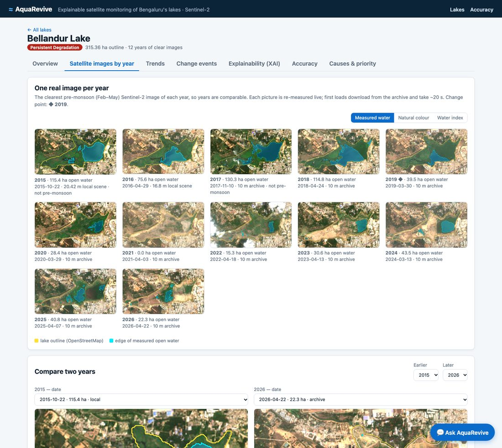
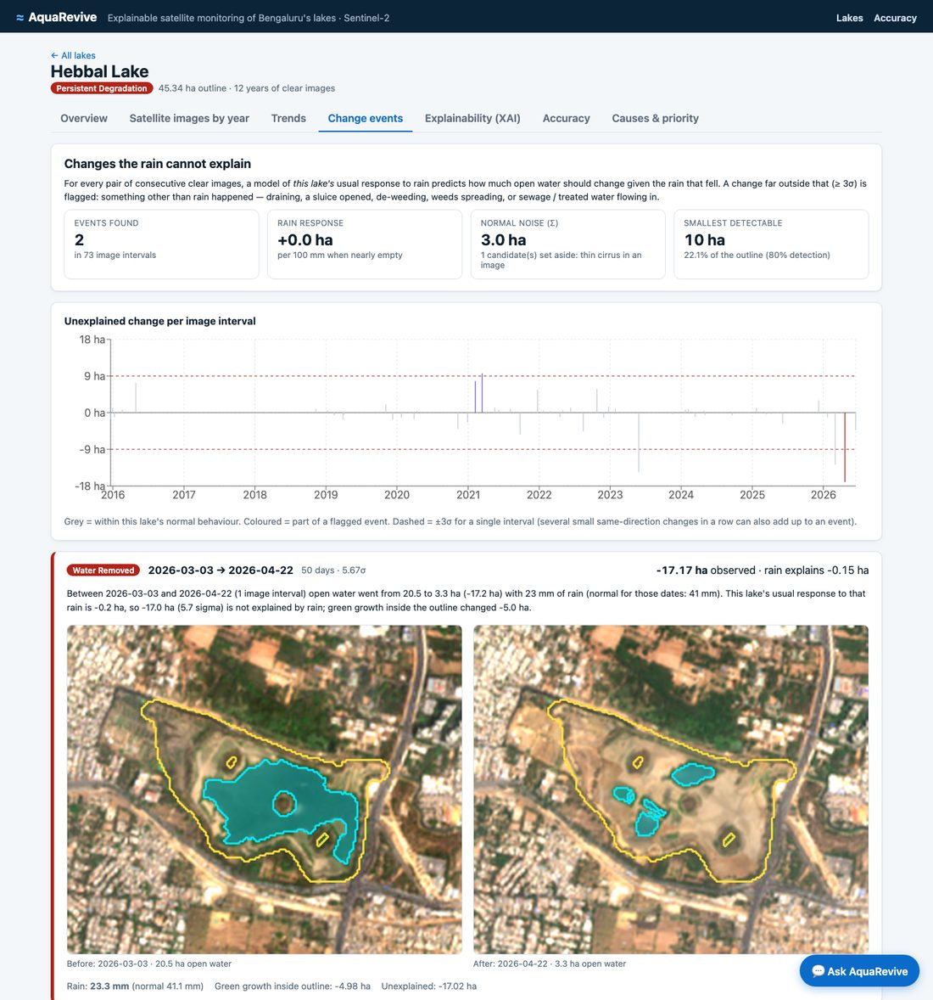
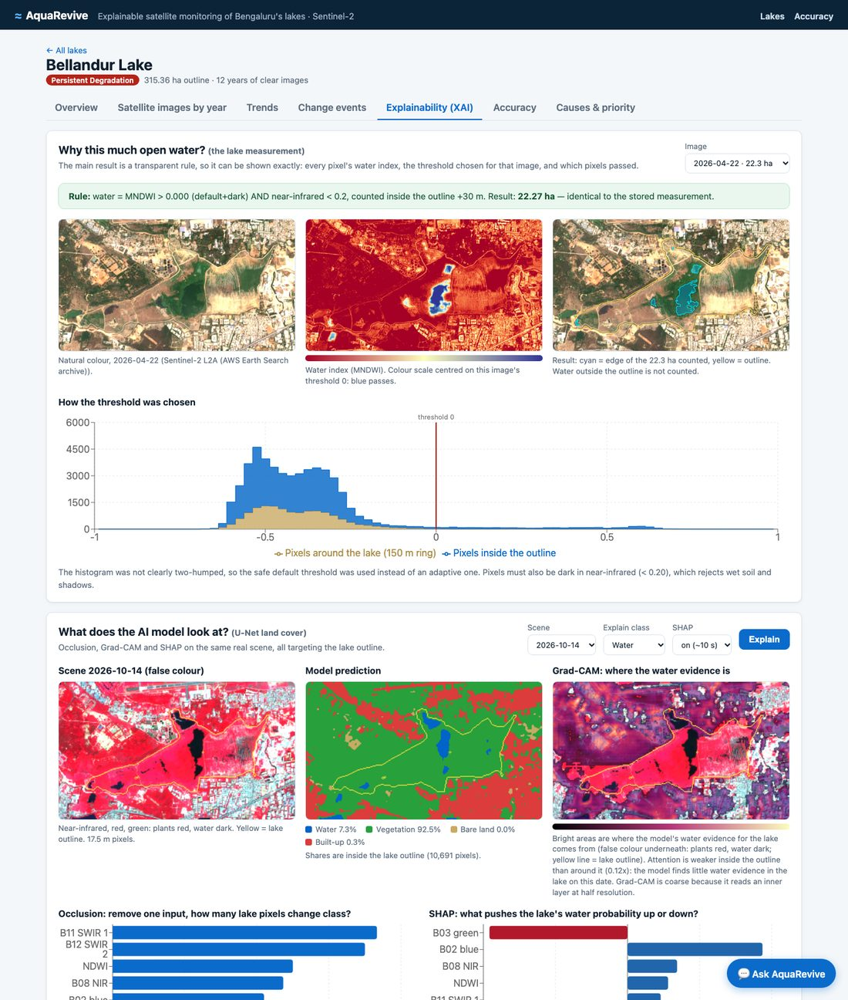
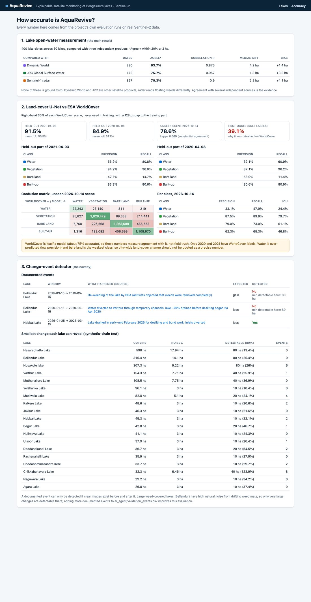

# AquaRevive

**Explainable AI for satellite-based waterbody and land-degradation assessment in Bengaluru.**

AquaRevive measures the open water of Bengaluru's well-known lakes on real Sentinel-2
satellite images (2015–2026), compares each lake with its own normal for the season,
flags changes that the rain cannot explain (draining, weeds, sewage inflow), and shows
*why* — every number can be traced back to the image and the rule that produced it.



## What it does

| | |
|---|---|
| **Lake measurement** | Open water (ha) of 35 well-known lakes on every clear Sentinel-2 pass, inside each lake's OpenStreetMap outline. Cloudy dates are skipped, never guessed. |
| **Seasonal comparison** | Each measurement vs the same months in other years → *normal*, *below normal*, *persistent degradation*. |
| **Satellite images by year** | The real image behind each yearly number, re-measured live, with the measured water edge drawn on it. |
| **Change events** *(novelty)* | Changes in open water that rainfall (CHIRPS) cannot explain, classified as *water removed*, *plants covered water*, *plants cleared* or *inflow without rain*, with before/after images. |
| **Explainability (XAI)** | The measurement rule shown pixel by pixel (water index, threshold, histogram); the U-Net land-cover model explained with occlusion, Grad-CAM and SHAP. |
| **Accuracy** | Measurement vs three independent products; land-cover model vs ESA WorldCover; detection power of the change detector. |
| **Priority & alerts** | A restoration ranking and alerts for lakes below normal. |
| **Ask AquaRevive** | A chatbot that answers only from the project's data (optional free local AI model; every number checked). |
| **Live** | A background updater measures new satellite passes every 6 hours. |

| Images by year | Change events |
|---|---|
|  |  |

| Explainability | Accuracy |
|---|---|
|  |  |

## The novelty: changes the rain cannot explain

Bengaluru's lakes are managed, sewage-fed tanks: over years their water level is set by
people more than by rain (yearly rainfall is significantly linked to water for only 2 of
19 lakes). But over a few weeks, rain clearly drives the change. So for every pair of
consecutive clear images a per-lake **rain-response model** predicts how much the water
*should* change given the rain that fell; changes ≥ 3σ beyond it are flagged.

- Robust noise scale (MAD) and **CUSUM-style episodes**, so gradual draining over several images is caught.
- **Thin-cirrus filter** — haze fakes a water loss; it removed 20 of 48 raw detections.
- **Detection power** per lake from synthetic drains injected into the real data: ~10 ha for most lakes, 40–80 ha for large weed-covered ones.
- Validated against documented events (`ai_agent/validation_events.csv`), e.g. the February 2026 draining of Hebbal Lake.

## Accuracy (from the project's own evaluation runs)

| What | Result |
|---|---|
| Open water vs JRC Global Surface Water / Sentinel-1 radar / Dynamic World (400 lake-dates) | r = 0.96 / 0.90 / 0.88 |
| Land-cover U-Net, held-out WorldCover pixels (2021 / 2020) | 91.5% / 84.9% |
| Land-cover U-Net, unseen October 2026 scene | 78.6% (kappa 0.67) |

Limits, stated honestly: WorldCover is itself a model (~75%); the land-cover model
over-predicts water and is weak on bare land; rainfall explains short-term changes only;
large weed-covered lakes reveal only large changes. See
`ai_agent/ACCURACY_AND_LIMITATIONS.md`.

## How it is built

```
frontend/   React + Vite website (map, lake pages, chatbot)          :5173
backend/    FastAPI + SQLite API; proxies the AI service              :8000
ai_agent/   FastAPI AI service                                        :8001
  app/        lake_analytics (measurements, anomaly, ranking), imagery (real images),
              events (change detector), xai (occlusion / Grad-CAM / SHAP), accuracy,
              rainfall, chat
  scripts/    lake_water_timeseries (measure lakes), live_update (keep it live),
              fetch_rainfall (CHIRPS), train/evaluate the land-cover U-Net, ...
```

## Run it locally (macOS)

```bash
# 1. AI service (port 8001) — from the project root, with the Python venv
source .venv/bin/activate
uvicorn ai_agent.app.main:app --port 8001

# 2. Backend (port 8000)
cd backend && source ../.venv/bin/activate && uvicorn app.main:app --port 8000

# 3. Website (port 5173)
cd frontend && npm install && npm run dev        # open http://localhost:5173

# Optional: keep data live, refresh rainfall, enable the AI chatbot
python ai_agent/scripts/live_update.py
python ai_agent/scripts/fetch_rainfall.py --source ee --project <earth-engine-project>
brew install ollama && ollama pull qwen2.5:7b
```

More detail in `frontend/README.md`. The raw Sentinel-2 scenes used to train the
land-cover model (`ai_agent/data/raw`, `ai_agent/data/extracted`, 2.35 GB, Git LFS) are in
the team repository.

## Data and credits

- Sentinel-2 L2A — Copernicus / ESA (AWS Earth Search archive and downloaded scenes)
- ESA WorldCover 2020/2021 — CC BY 4.0
- Lake outlines — © OpenStreetMap contributors, ODbL
- Rainfall — CHIRPS v2.0 (Funk et al. 2015, *Scientific Data*), via Google Earth Engine
- Cross-checks — Google Dynamic World, JRC Global Surface Water, Sentinel-1

Third-semester Experiential Learning (EL) project.
